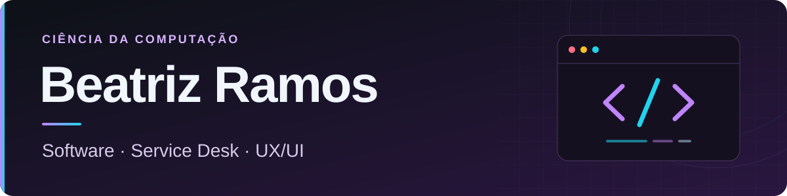

  

### Olá! Sou a Beatriz 👋

**Estudante de Ciência da Computação e técnica em TI, com experiência em desenvolvimento de sistemas e Service Desk.**

## 👩‍💻 Sobre mim

Gosto de transformar necessidades reais em soluções tecnológicas úteis. Minha experiência inclui desenvolvimento e manutenção de aplicações web, implementação de funcionalidades, correção de bugs, consultas SQL, dashboards, suporte técnico e automação de processos.

- 🌱 **Aprendizado atual:** desenvolvimento full stack, APIs REST, bancos de dados, automação e Inteligência Artificial.
- ⚙️ **Operações de TI:** experiência com Service Desk, gestão de chamados, suporte a usuários e análise de indicadores.
- 🎨 **UX/UI:** wireframes, prototipação, Design Thinking, acessibilidade e interfaces responsivas.
- 🎯 **Objetivo:** oportunidades em desenvolvimento de software, TI, automação, dados ou UX/UI.

## 🛠️ Tecnologias e ferramentas

Tecnologias que utilizo em projetos, estudos e experiências profissionais.

**Linguagens**

**Desenvolvimento web**

**Bancos de dados**

**Versionamento, ambiente e design**

## 🎓 Formação

| Formação | Instituição | Situação |
| :--- | :--- | :--- |
| Ciência da Computação | Centro Universitário FMU | Cursando · conclusão prevista em 2028 |
| Técnico em Tecnologia da Informação | Senac Lapa Tito | Concluído |

**Idiomas:** Português nativo · Inglês intermediário · Espanhol intermediário

<strong>📊 Estatísticas do GitHub</strong>

 

  
  

---

**Vamos conversar?**

Aberta a oportunidades e colaborações em tecnologia.

[Entre em contato pelo LinkedIn](https://www.linkedin.com/in/beatriz-ramos-4046a8289)

